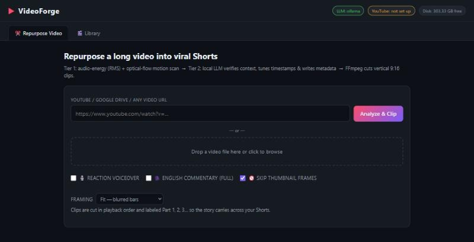

# VideoForge — turn long videos into YouTube Shorts

Paste a YouTube link (or pick a video file from your PC), and VideoForge finds the best
moments, cuts them into vertical 9:16 Shorts (1080x1920) with a title on top, and can
upload them straight to your YouTube channel. Runs on your own PC, **free**.



---

## What you need

- Windows 10 or 11, a laptop or PC with 8 GB RAM, and about 10 GB of free disk space. **No graphics card needed.**
- Internet access.
- A Google account, to get a free AI key (2 minutes).

## One-time setup (about 10–15 minutes)

1. On this GitHub page click the green **Code** button → **Download ZIP**.
2. Right-click the ZIP → **Properties** → tick **Unblock** → **OK**.
3. Extract it to a folder with space, e.g. `D:\VideoForge`.
4. Double-click **`Install.bat`**. If Windows says "protected your PC", click **More info → Run anyway**.
5. When it asks for the **Groq key**, let it open the website. Sign in with Google, click
   **Create API Key**, copy the key, paste it into the black window and press Enter.
6. When it finishes, it puts a **VideoForge** shortcut on your desktop.

## Making Shorts

1. Double-click the **VideoForge** shortcut. A black window opens (**keep it open**) and your browser opens the app.
2. In the **✂️ Repurpose Video** tab, either:
   - **paste a YouTube link** of your video and click **Analyze & Clip**, or
   - **drag in a video file** from your laptop, or click the box to browse.
3. Choose your options before starting:
   - **Framing:** **Fit** keeps the whole frame, with blurred bars above and below. **Full portrait**
     crops to fill the phone screen; it's best when the action is in the middle.
   - **🎙️ Reaction voiceover:** an AI voice says a short hype line at the start of each clip.
   - **🗣️ English commentary:** a full English narration over the clip. Use it for videos in another language.
4. Wait while the progress bar runs. Expect about **2–3 minutes per Short**, and a 10-minute video
   usually gives 3–6 Shorts. The AI picks the best moments, cuts them vertical (1080x1920), adds a
   title at the top, and labels them Part 1, 2, 3 in order.
5. Open the **🎬 Library** tab to watch, download or delete your Shorts. The files are also saved in
   the `media\clips` folder inside VideoForge.

## Important

- **One video at a time.** Wait for the current one to finish before adding the next.
- To stop the app, close the black window.
- If something breaks, run **`Install.bat`** again; it's safe to re-run. If a YouTube link won't
  download, re-run it and restart the PC.

## Upload to YouTube (optional, free, one-time setup ~10 min)

You can always just download the clips and upload them yourself. To let VideoForge upload
for you:

1. Go to [console.cloud.google.com](https://console.cloud.google.com) → create a project.
2. **APIs & Services → Library** → search **YouTube Data API v3** → **Enable**.
3. **OAuth consent screen** → External → fill in the app name and your email →
   under **Test users** add your own Gmail.
4. **Credentials → Create credentials → OAuth client ID → Desktop app** → **Download JSON**.
5. Rename the file to **`client_secret.json`** and put it in the VideoForge folder.
   Restart VideoForge.

The first upload opens a Google sign-in in your browser — pick your channel. YouTube's
free limit is **6 uploads per day**. Uploads are checked to be vertical and under 3 minutes
so YouTube treats them as Shorts. Because the Google app stays in "Testing" mode, Google
may ask you to sign in again about once a week — that's normal.

> **Keep `client_secret.json`, `yt_token_*.json` and `.env` private** — they are your
> passwords to your channel and AI key. Never share or upload them.

## PC requirements

| | Minimum | Better |
|---|---|---|
| Windows | 10 or 11, 64-bit | 11 |
| CPU | 4 cores (Intel i5 / Ryzen 5, 2018 or newer) | 6+ cores |
| RAM | 8 GB | 16 GB |
| Graphics card | **Not needed** — everything runs on the CPU | |
| Free disk | 6 GB for the app + room for your videos (10 GB+ recommended) | SSD |
| Internet | needed (YouTube downloads, AI titles, voices, uploads) | |

## Settings & troubleshooting

- **Settings** live in the `.env` file (open with Notepad). Restart VideoForge after editing.
- **Add/change the AI key later**: put `GROQ_API_KEY=gsk_...` in `.env`.
- **Want AI without internet?** Run `setup_ollama.ps1` (right-click → Run with PowerShell).
  Needs ~5 GB more disk and works best with 16 GB RAM.
- **A YouTube link won't download**: run `Install.bat` again (it updates the downloader
  pieces), then restart the PC.
- **Something broke?** Run `Install.bat` again — it's safe to re-run any time.
- **"Address already in use"**: VideoForge is already running — just open
  <http://127.0.0.1:8321>.

## For developers

```
backend/
  main.py        FastAPI + threaded job queue, REST API, static serving
  ingest.py      yt-dlp downloads (YouTube/Drive/1000+ sites) + caption parsing
  tier1.py       heuristic pre-filter: audio RMS (numpy) + optical flow (OpenCV)
  transcribe.py  faster-whisper speech-to-English for caption-less videos
  llm.py         Ollama / Groq / OpenRouter client, heuristic fallback
  repurpose.py   clip pipeline orchestration
  media_utils.py FFmpeg helpers (bundled ffmpeg via imageio-ffmpeg)
  youtube_up.py  YouTube Data API v3 upload (multi-channel, quota-aware)
frontend/        single-page UI (no build step)
```

Multiple channels under one Google account: copy `channels.example.json` to
`channels.json` and edit it.

## License

[MIT](LICENSE) — free to use, modify and share; keep the copyright notice.
